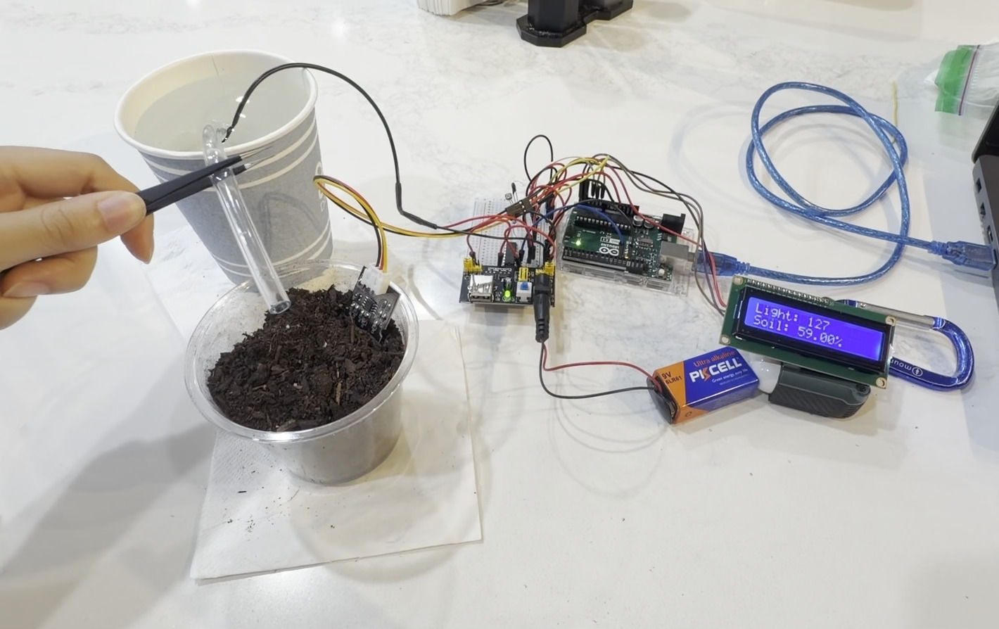
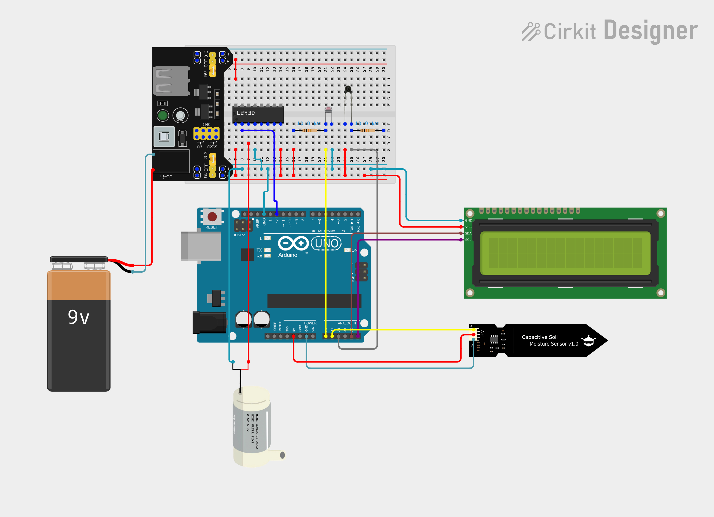

# Plant Moisture Monitor

An Arduino-based automated plant care system that monitors soil moisture, ambient light, and temperature — and automatically waters the plant when the soil gets too dry.

## Overview
This project uses an Arduino Uno with a capacitive soil moisture sensor, a light sensor, and an NTC thermistor to monitor a plant's environment in real time. Readings are displayed on a 16x2 I2C LCD, and a mini water pump is triggered automatically when soil moisture drops below 35%.

## Circuit Diagram

## How It Works
- **Capacitive soil moisture sensor:** reads soil moisture level (converted to a percentage)
- **Light sensor (photoresistor):** reads ambient light level
- **NTC thermistor:** calculates temperature in °C and °F using the Beta parameter equation
- **16x2 I2C LCD:** cycles between displaying temperature, and light/soil readings
- **Mini water pump + L293D driver:** automatically activates for 3 seconds when soil moisture falls below 35%, then re-initializes the LCD to prevent display corruption

## Components
| Component | Purpose |
|---|---|
| Arduino Uno | Main microcontroller |
| Breadboard Power Supply Module | Provides regulated 5V/3.3V power to the breadboard rails |
| Capacitive Soil Moisture Sensor v1.0 | Measures soil moisture |
| Photoresistor | Measures ambient light |
| NTC Thermistor | Measures temperature |
| 10kΩ Resistor (x2) | Pull-down/voltage divider resistors for sensor circuits |
| L293D Motor Driver | Controls water pump |
| Mini Water Pump (2.5V, 9V) | Waters the plant automatically |
| 16x2 I2C LCD | Displays sensor readings |
| 9V Battery | Power source |

## Code
Full source code: [`src/plant_monitor.ino`](src/plant_monitor.ino)

## Demo Video
Watch the plant monitor in action: [YouTube Demo](https://youtu.be/ndHWT7kaMkk)

## What I Learned
- Interfacing multiple analog sensors (soil moisture, light, thermistor) with an Arduino
- Converting raw NTC thermistor readings into temperature using the Beta parameter formula
- Automating a physical actuator (water pump) based on live sensor thresholds
- Using I2C communication to drive an LCD display
